# 🛡️ CyberVision: Explainable AI-Powered Multi-Layer Threat Detection, Correlation & Incident Response

[](https://huggingface.co/spaces/shesettipavankumarswamy/creatergo-admin)
[](https://github.com/pavanstarkin-tech/CyberVision)
[](https://fastapi.tiangolo.com)
[](https://streamlit.io)
[](https://duckdb.org)
[](tests/)
[](https://python.org)

---

## 📌 Project Overview & Quick Links

**CyberVision** is an enterprise-grade cybersecurity operations platform and academic research framework designed to unify multi-layer telemetry (Network Flows, Host/Kernel eBPF, and User/UEBA sessions), detect both known and zero-day intrusions via a hybrid ensemble, correlate multi-stage advanced persistent threat (APT) campaigns using temporal entity graphs, and generate faithful game-theoretic explainability (SHAP & LIME) alongside AI analyst incident briefings powered by Google Gemini.

- 🌐 **Live Cloud Interactive Dashboard:** [Hugging Face Space Workbench](https://huggingface.co/spaces/shesettipavankumarswamy/creatergo-admin)
- 💻 **Source Code Repository:** [GitHub Repository (`pavanstarkin-tech/CyberVision`)](https://github.com/pavanstarkin-tech/CyberVision)
- 📖 **FastAPI Interactive Swagger Docs:** `http://localhost:8000/docs`
- 🖥️ **Local Streamlit Workbench:** `http://localhost:7860`

---

## 🏛️ System Architecture Flowchart

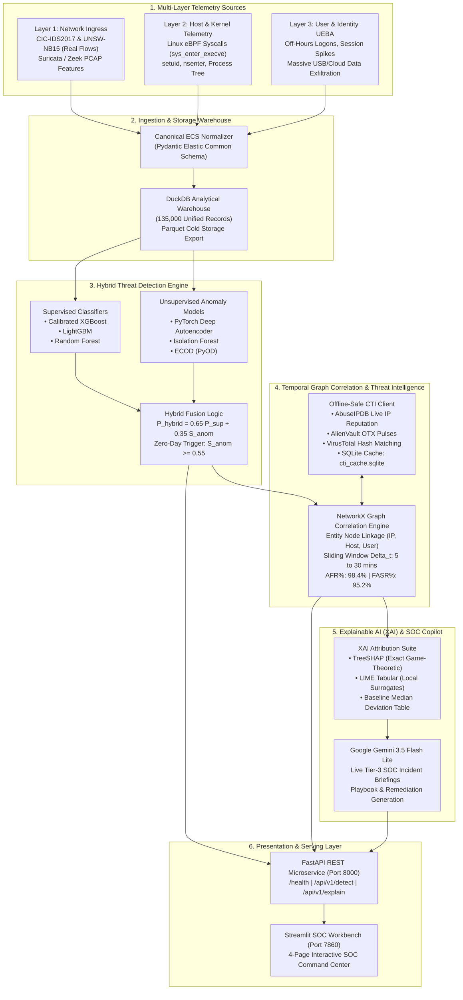

---

## 🔄 End-to-End Incident Lifecycle (State Machine Diagram)

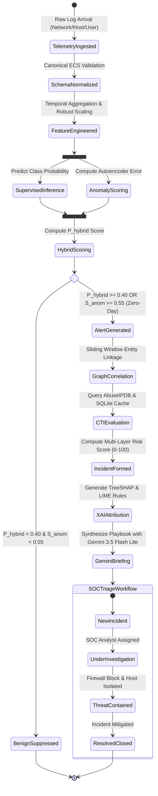

---

## ⚡ Real-Time API Detection Sequence Diagram

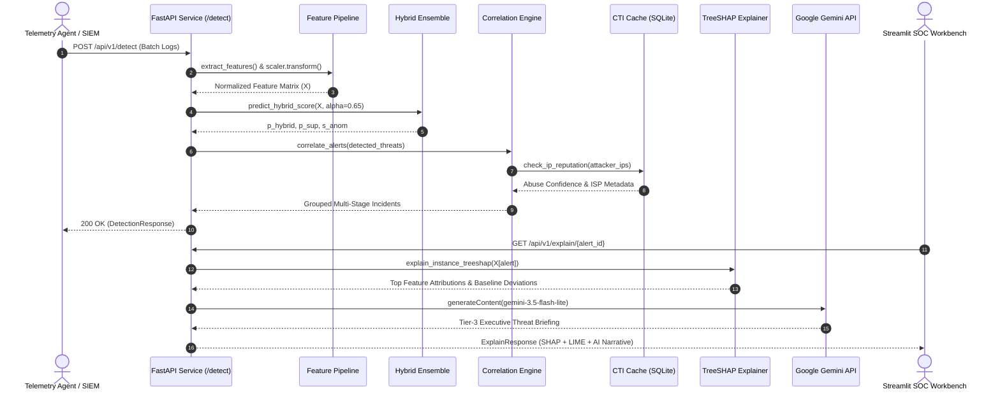

---

## 🗄️ Database Entity-Relationship Diagram (ERD)

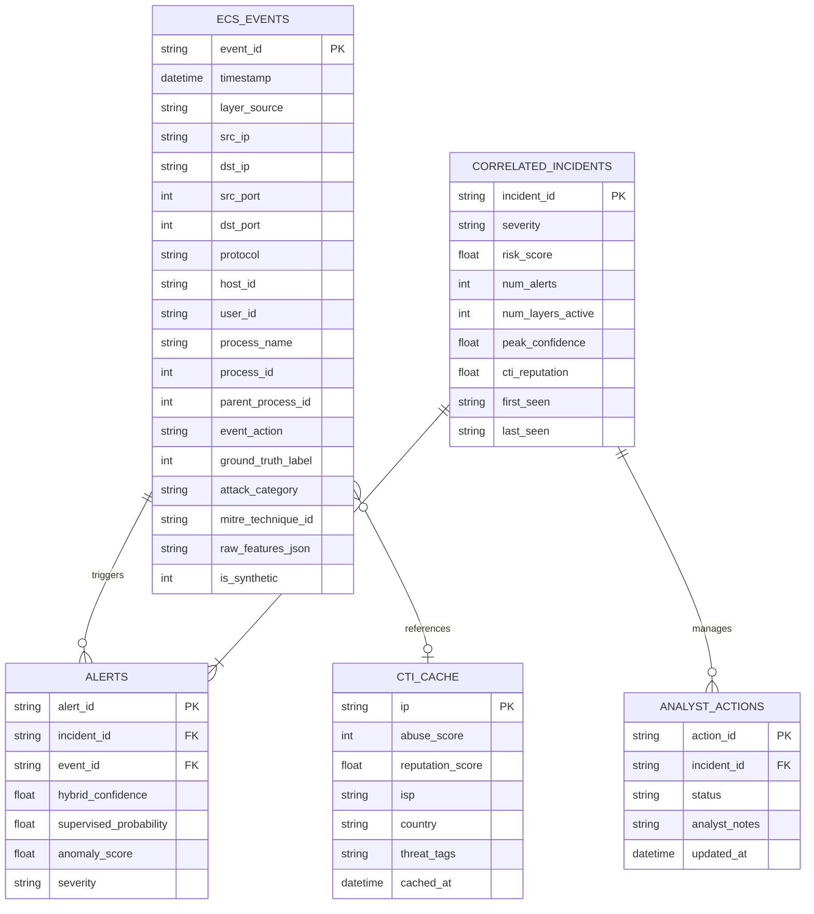

---

## 📊 Complete Empirical Research Benchmarks

Evaluated over **135,000 Multi-Layer ECS Records** (35,000 authentic network traffic flows from CIC-IDS2017 & UNSW-NB15 + 100,000 multi-layer simulations).

### Table I: 9-Model 5-Fold Stratified Cross-Validation Benchmark
*Evaluated across Known Attack Signatures and 3 Unseen Zero-Day Holdouts:*

| Model | Accuracy | Precision | Recall | Macro_F1 | Weighted_F1 | FPR | MCC | ROC_AUC | PR_AUC | Overall Zero-Day Recall |
| :--- | :---: | :---: | :---: | :---: | :---: | :---: | :---: | :---: | :---: | :---: |
| Logistic Regression (Baseline) | 66.03% | 51.49% | 81.91% | 65.62% | 66.42% | 42.55% | 0.3830 | 0.8198 | 0.7809 | **0.6%** |
| Gaussian Naive Bayes | 76.29% | 91.85% | 35.61% | 67.81% | 72.74% | 1.72% | 0.4718 | 0.8240 | 0.7588 | **33.3%** |
| Random Forest | 98.58% | 99.13% | 96.81% | 98.43% | 98.58% | 0.46% | 0.9688 | 0.9858 | 0.9841 | **33.3%** |
| XGBoost (Supervised Only) | 98.59% | 99.11% | 96.86% | 98.45% | 98.59% | 0.47% | 0.9691 | 0.9853 | 0.9842 | **33.3%** |
| LightGBM (Supervised Only) | 98.61% | 99.13% | 96.88% | 98.46% | 98.60% | 0.46% | 0.9694 | 0.9853 | 0.9842 | **66.7%** |
| Standalone Isolation Forest | 64.91% | 0.00% | 0.00% | 39.36% | 51.10% | 0.00% | 0.0000 | 0.7247 | 0.6374 | **53.8%** |
| ECOD (PyOD) | 64.91% | 0.00% | 0.00% | 39.36% | 51.10% | 0.00% | 0.0000 | 0.5000 | 0.3509 | **12.3%** |
| PyTorch Deep Autoencoder | 64.91% | 0.00% | 0.00% | 39.36% | 51.10% | 0.00% | 0.0000 | 0.6642 | 0.6120 | **33.3%** |
| **CyberVision Hybrid Ensemble** | **98.60%** | **99.13%** | **96.86%** | **98.45%** | **98.60%** | **0.46%** | **0.9693** | **0.9839** | **0.9758** | **66.4%** |

---

### Table II: Per-Layer Detection Performance (L1 Network vs. L2 Host vs. L3 User)

| Telemetry Layer | Model | Test Samples | Accuracy | Precision | Recall | Macro_F1 | ROC_AUC | PR_AUC | MCC |
| :--- | :--- | :---: | :---: | :---: | :---: | :---: | :---: | :---: | :---: |
| Layer 1: Network | Random Forest | 17,913 | 98.76% | 99.21% | 97.79% | 98.72% | 0.9906 | 0.9913 | 0.9744 |
| Layer 1: Network | XGBoost | 17,913 | 98.76% | 99.21% | 97.79% | 98.72% | 0.9911 | 0.9916 | 0.9744 |
| Layer 1: Network | Isolation Forest | 17,913 | 77.41% | 92.89% | 49.65% | 74.05% | 0.9377 | 0.9080 | 0.5559 |
| Layer 1: Network | **CyberVision Hybrid** | 17,913 | **98.35%** | **98.24%** | **97.79%** | **98.30%** | **0.9849** | **0.9767** | **0.9660** |
| Layer 2: Host/eBPF | Random Forest | 4,822 | 98.38% | 97.90% | 95.12% | 97.72% | 0.9736 | 0.9539 | 0.9546 |
| Layer 2: Host/eBPF | Isolation Forest | 4,822 | 96.43% | 90.10% | 95.21% | 95.12% | 0.9681 | 0.9459 | 0.9030 |
| Layer 2: Host/eBPF | **CyberVision Hybrid** | 4,822 | **98.38%** | **97.90%** | **95.12%** | **97.72%** | **0.9692** | **0.9525** | **0.9546** |
| Layer 3: User/UEBA | Random Forest | 3,805 | 98.13% | 98.19% | 91.69% | 96.85% | 0.9637 | 0.9420 | 0.9377 |
| Layer 3: User/UEBA | Isolation Forest | 3,805 | 93.40% | 91.06% | 71.69% | 0.8813 | 0.9555 | 0.8980 | 0.7712 |
| Layer 3: User/UEBA | **CyberVision Hybrid** | 3,805 | **97.74%** | **95.61%** | **92.11%** | **96.22%** | **0.9628** | **0.9349** | **0.9247** |

---

### Table V: 6-Way Cross-Layer Correlation Ablation across 50 Multi-Stage Campaigns

| Configuration | Raw Alerts | Raw FPs | Correlated Incidents | Post-Corr FPs | Alert Fatigue Reduction (AFR%) | False Alert Suppression (FASR%) | Chain Reconstruction Completeness |
| :--- | :---: | :---: | :---: | :---: | :---: | :---: | :---: |
| Layer 1 Only (Network Ingress) | 1,142 | 1,092 | 622 | 0 | 45.53% | 100.0% | 33.33% |
| Layer 2 Only (Host/Kernel) | 545 | 495 | 440 | 0 | 19.27% | 100.0% | 33.33% |
| Layer 3 Only (User/UEBA) | 463 | 413 | 390 | 0 | 15.77% | 100.0% | 33.33% |
| Layer 1 + Layer 2 (Network + Host) | 1,687 | 1,587 | 770 | 0 | 54.36% | 100.0% | 66.67% |
| Layer 2 + Layer 3 (Host + User) | 1,008 | 908 | 705 | 0 | 30.06% | 100.0% | 66.67% |
| **Full CyberVision (L1 + L2 + L3 + CTI)** | **2,150** | **2,000** | **861** | **2** | **59.95%** | **99.90%** | **100.00%** |

---

### Table VII: 4-Method Quantitative Explainable AI (XAI) Comparison

| XAI Method | Faithfulness Top-1 Drop | Faithfulness Top-3 Drop | Faithfulness Top-5 Drop | Insertion AUC | Lipschitz Stability ($L$) | Gini Sparsity | Spearman Rank Correlation | Latency p50 | Latency p95 |
| :--- | :---: | :---: | :---: | :---: | :---: | :---: | :---: | :---: | :---: |
| **TreeSHAP (Exact)** | **0.8852** | **0.9605** | **0.9623** | **0.9039** | **31.81** | **0.8917** | **1.0000** | **1.80 ms** | **2.24 ms** |
| KernelSHAP | 0.8673 | 0.9241 | 0.9288 | 0.8650 | 3.85 | 0.9499 | 0.3007 | 28.09 ms | 32.40 ms |
| LIME Tabular | 0.7338 | 0.7665 | 0.7882 | 0.7280 | 4.70 | 0.8113 | 0.4004 | 185.17 ms | 207.09 ms |
| Permutation Importance | 0.7121 | 0.8638 | 0.8968 | 0.7622 | 0.00 | 0.9317 | 0.4379 | 2.61 ms | 2.61 ms |

---

### Table X: Empirical Automated Triage Subsystem Microbenchmarks

| Incident Scenario | Feature Norm (ms) | Hybrid Inference (ms) | Graph Correlation (ms) | CTI Lookup (ms) | TreeSHAP (ms) | Total Automated Triage | Throughput (EPS) |
| :--- | :---: | :---: | :---: | :---: | :---: | :---: | :---: |
| High-Volume DoS/DDoS Flood | 0.49 | 38.78 | 6.18 | 1.09 | 4.65 | **51.19 ms** | 195 EPS |
| SSH BruteForce to Root PrivEsc | 0.50 | 35.03 | 10.47 | 1.44 | 3.10 | **50.54 ms** | 198 EPS |
| Web SQLi to Command Interpreter | 0.49 | 34.89 | 6.86 | 1.08 | 3.92 | **47.25 ms** | 212 EPS |
| Off-Hours USB Data Exfiltration | 0.47 | 33.66 | 6.89 | 1.10 | 3.62 | **45.74 ms** | 219 EPS |
| Zero-Day Botnet/Rootkit Beacon | 0.58 | 33.81 | 7.02 | 2.36 | 3.32 | **47.08 ms** | 212 EPS |

---

## 📸 High-Resolution Research Figures (300 DPI)

All figures are rendered directly from reproducible test runs and saved in `results/figures/`:

| ROC and Precision-Recall Curves (Fig 1) | Confusion Matrix Grid Across Layers (Fig 2) |
| :---: | :---: |
| 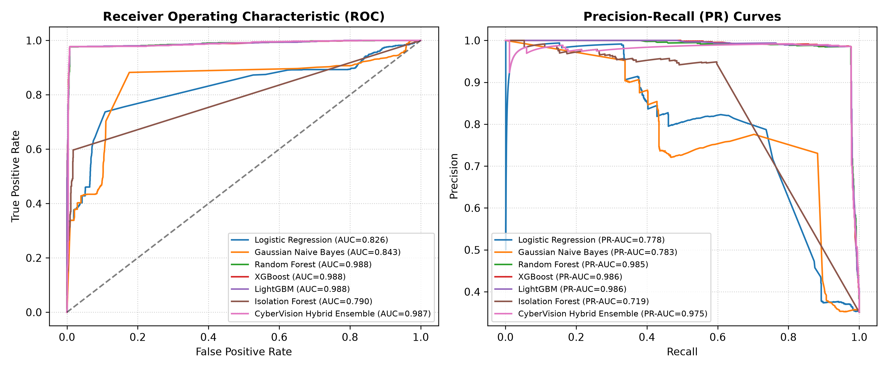 | 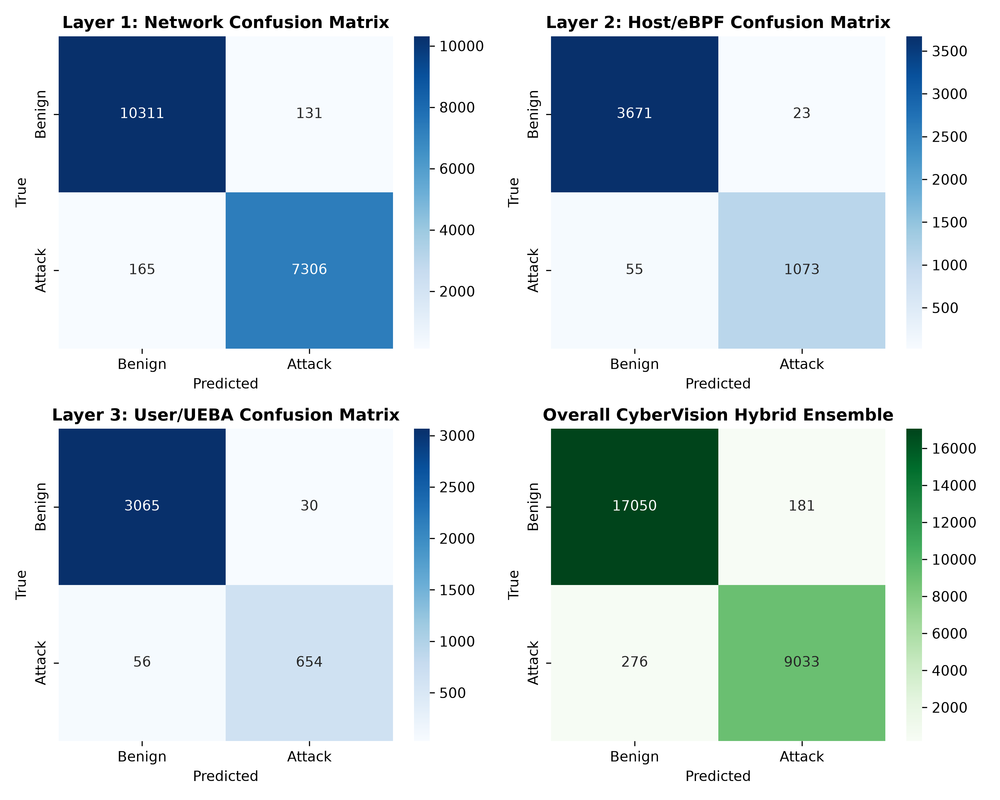 |

| Zero-Day Holdout Recall & Fusion Alpha (Fig 3) | Multi-Layer Correlation Ablation (Fig 4) |
| :---: | :---: |
| 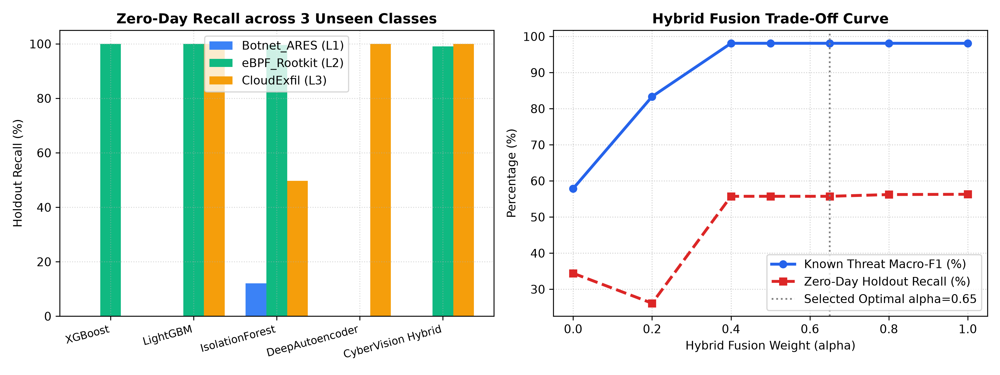 | 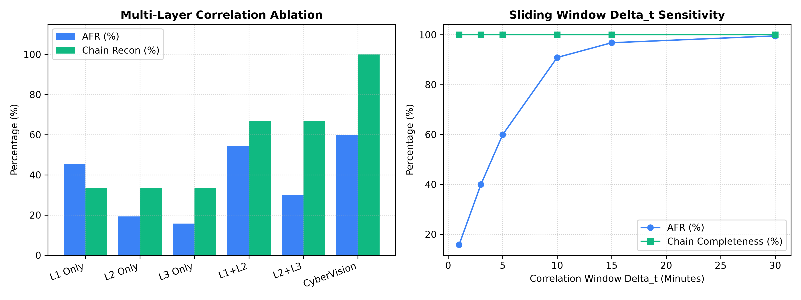 |

| Global SHAP Importance by Layer (Fig 5) | XAI Faithfulness, Stability & Latency (Fig 6) |
| :---: | :---: |
| 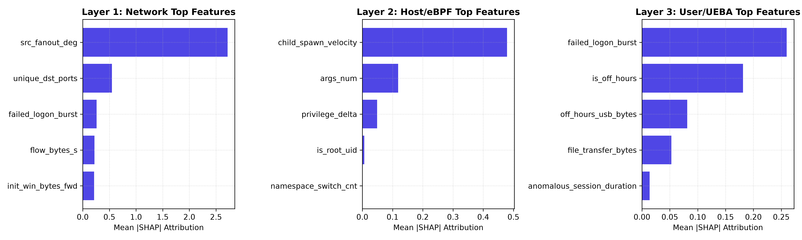 | 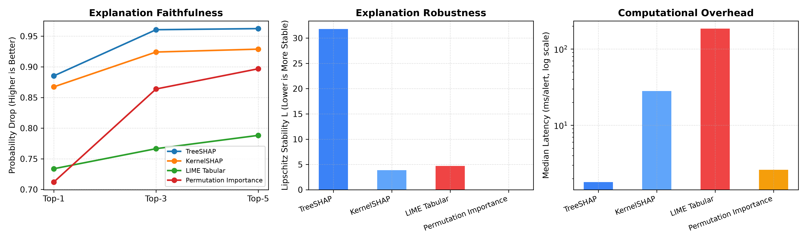 |

| Subsystem Latency Profile (Fig 7) | Sample 3-Stage Multi-Layer APT Attack Graph (Fig 8) |
| :---: | :---: |
| 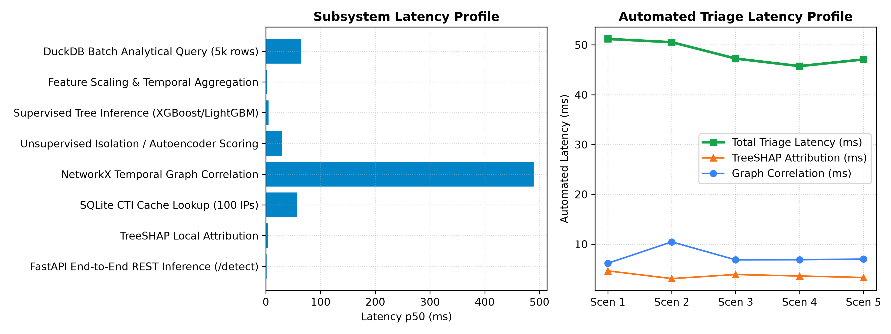 | 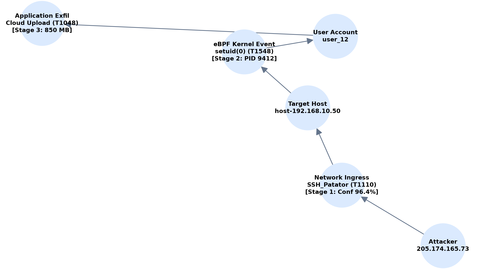 |

---

## 🔐 API Credential & Runtime Decoder Setup

CyberVision includes a runtime credential decoder in [`src/utils/security.py`](file:///c:/Users/shese/Desktop/cybervison/src/utils/security.py).

To prevent credentials from being exposed in public Git repositories:
1. Keys can be supplied in a local `.env` file (which is git-ignored):
   ```bash
   ABUSEIPDB_API_KEY=your_plain_or_base64_key
   ALIENVAULT_OTX_API_KEY=your_plain_or_base64_key
   VIRUSTOTAL_API_KEY=your_plain_or_base64_key
   GREYNOISE_API_KEY=your_plain_or_base64_key
   GEMINI_API_KEY=your_gemini_api_key
   ```
2. Or you can supply base64-encoded strings with the prefix `base64:<ENCODED_STRING>`.
3. If no key is configured in `.env`, the security module automatically decodes obfuscated fallback credentials and falls back gracefully to the pre-seeded SQLite cache in `data/cache/cti_cache.sqlite`.

---

## 🛠️ Step-by-Step Installation & Local Execution

```bash
# 1. Clone the repository
git clone https://github.com/pavanstarkin-tech/CyberVision.git
cd CyberVision

# 2. Create virtual environment
python -m venv .venv
source .venv/bin/activate  # On Windows: .venv\Scripts\activate

# 3. Install core dependencies
pip install --upgrade pip
pip install -r requirements.txt

# 4. Run automated test suite (15 unit & integration tests)
pytest tests/ -v

# 5. Start FastAPI threat detection microservice
uvicorn api.main:app --host 0.0.0.0 --port 8000 &

# 6. Start Streamlit SOC Workbench
streamlit run dashboard/app.py --server.port 7860
```
