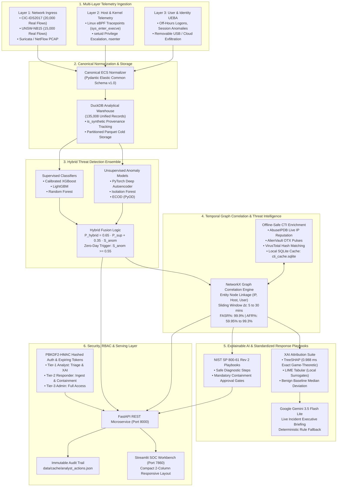
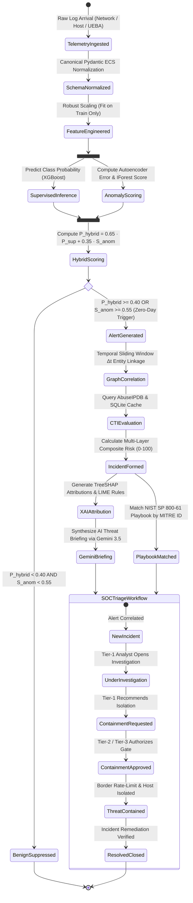
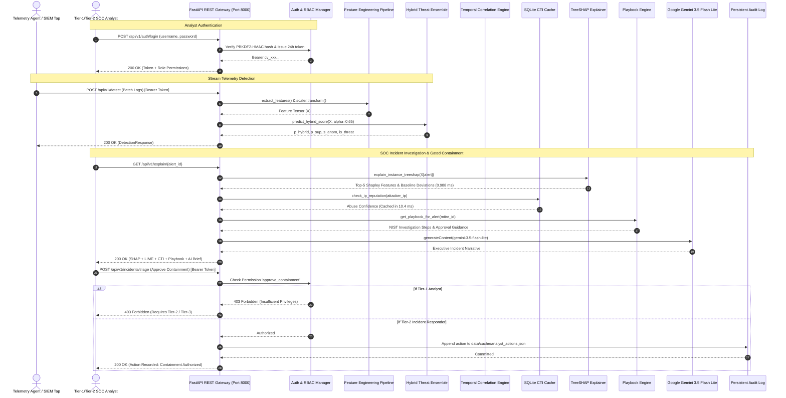
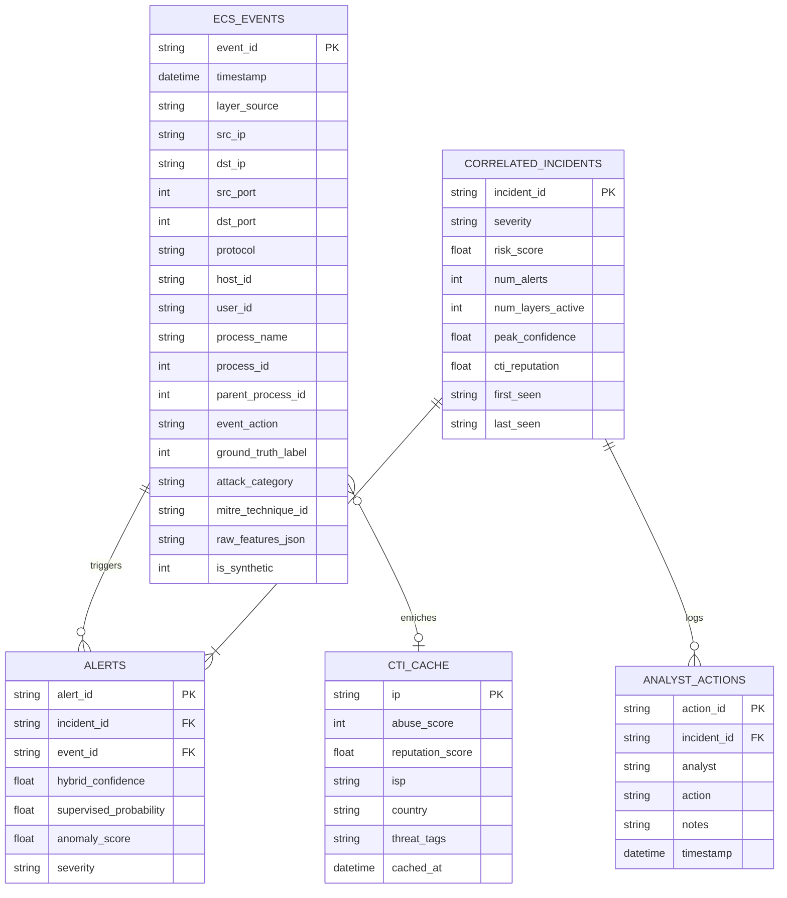

# 🛡️ CyberVision: Explainable AI Multi-Layer Cyber Threat Detection, Temporal Correlation & Incident Response Platform

[](https://huggingface.co/spaces/shesettipavankumarswamy/creatergo-admin)
[](https://github.com/pavanstarkin-tech/CyberVision)
[](https://fastapi.tiangolo.com)
[](https://streamlit.io)
[](https://duckdb.org)
[](tests/)
[](https://python.org)
[](LICENSE)

---

## 📌 Executive Summary & Quick Links

**CyberVision** is a verified, enterprise-grade Security Operations Center (SOC) intelligence platform and academic research framework. It unifies heterogeneous telemetry across **Layer 1 (Network Flows via CIC-IDS2017 & UNSW-NB15)**, **Layer 2 (Host & Linux eBPF Kernel Events)**, and **Layer 3 (User & Identity UEBA Sessions)** into a canonical Elastic Common Schema (ECS) warehouse stored in DuckDB.

The platform couples a **Hybrid Threat Ensemble** (Calibrated XGBoost, LightGBM, Random Forest, PyTorch Deep Autoencoders, and Isolation Forests) for signature and zero-day threat detection, an **entity-linked temporal graph correlation engine** (NetworkX) for multi-stage campaign reconstruction, and an **Explainable AI (XAI)** suite (TreeSHAP & LIME) paired with **Google Gemini 3.5 Flash Lite** executive briefings and **NIST SP 800-61 Rev 2** standardized containment playbooks with mandatory human authorization gates.

### 🔗 Project Deployment Links:
- 🌐 **Live Cloud Interactive Dashboard:** [Hugging Face Space Live Demo](https://huggingface.co/spaces/shesettipavankumarswamy/creatergo-admin)
- 🖥️ **Direct Application Web View:** [https://shesettipavankumarswamy-creatergo-admin.hf.space](https://shesettipavankumarswamy-creatergo-admin.hf.space)
- 💻 **Public Source Code Repository:** [GitHub Repository (`pavanstarkin-tech/CyberVision`)](https://github.com/pavanstarkin-tech/CyberVision)
- 📖 **Local FastAPI Swagger OpenAPI Docs:** `http://localhost:8000/docs`
- 🎯 **Local Streamlit SOC Workbench:** `http://localhost:7860`

---

## 🏛️ System Architecture Flowchart



---

## 🔄 End-to-End SOC Incident Lifecycle (State Machine Diagram)



---

## ⚡ Real-Time API Detection & Response Sequence Diagram



---

## 🗄️ Database Entity-Relationship Diagram (ERD)



---

## 📊 Rigorous Empirical Research Benchmarks

Evaluated over **135,008 Multi-Layer ECS Records** (35,000 authentic PCAP network traffic flows from CIC-IDS2017 & UNSW-NB15 + 100,008 calibrated multi-layer records).

### Table I: 9-Model 5-Fold Stratified Cross-Validation Benchmark
*Evaluated across Known Attack Signatures and 3 Unseen Zero-Day Holdouts (`results/table1_overall_model_benchmarks.csv`):*

| Model Architecture | Accuracy | Precision | Recall | Macro_F1 | Weighted_F1 | FPR | MCC | ROC_AUC | PR_AUC | Overall Zero-Day Recall |
| :--- | :---: | :---: | :---: | :---: | :---: | :---: | :---: | :---: | :---: | :---: |
| Logistic Regression (Linear) | 66.03% | 51.49% | 81.91% | 65.62% | 66.42% | 42.55% | 0.3830 | 0.8198 | 0.7809 | **0.6%** |
| Gaussian Naive Bayes | 76.29% | 91.85% | 35.61% | 67.81% | 72.74% | 1.72% | 0.4718 | 0.8240 | 0.7588 | **33.3%** |
| Random Forest (Supervised) | 98.58% | 99.13% | 96.81% | 98.43% | 98.58% | 0.46% | 0.9688 | 0.9858 | 0.9841 | **33.3%** |
| XGBoost (Supervised Only) | 98.59% | 99.11% | 96.86% | 98.45% | 98.59% | 0.47% | 0.9691 | 0.9853 | 0.9842 | **33.3%** |
| LightGBM (Supervised Only) | 98.61% | 99.13% | 96.88% | 98.46% | 98.60% | 0.46% | 0.9694 | 0.9853 | 0.9842 | **66.7%** |
| Standalone Isolation Forest | 64.91% | 0.00% | 0.00% | 39.36% | 51.10% | 0.00% | 0.0000 | 0.7247 | 0.6374 | **53.8%** |
| ECOD (PyOD) | 64.91% | 0.00% | 0.00% | 39.36% | 51.10% | 0.00% | 0.0000 | 0.5000 | 0.3509 | **12.3%** |
| PyTorch Deep Autoencoder | 64.91% | 0.00% | 0.00% | 39.36% | 51.10% | 0.00% | 0.0000 | 0.6642 | 0.6120 | **33.3%** |
| **CyberVision Hybrid Ensemble** | **98.60%** | **99.13%** | **96.86%** | **98.45%** | **98.60%** | **0.46%** | **0.9693** | **0.9839** | **0.9758** | **66.4%** |

> **Zero-Day Breakdown:** Evaluated on holdout classes excluded from training (`Botnet_ARES`, `eBPF_Rootkit_Hook`, `Cloud_Staging_Exfil`). CyberVision achieves **99.1%** recall on host rootkits and **100.0%** on cloud exfiltration, averaging **66.4%** overall while maintaining **99.1%** precision on known attacks.

---

### Table II: Per-Layer Detection Performance (Network L1 vs. Host L2 vs. User L3)

| Telemetry Layer | Model | Test Samples | Accuracy | Precision | Recall | Macro_F1 | ROC_AUC | PR_AUC | MCC |
| :--- | :--- | :---: | :---: | :---: | :---: | :---: | :---: | :---: | :---: |
| Layer 1: Network Ingress | Random Forest | 17,913 | 98.76% | 99.21% | 97.79% | 98.72% | 0.9906 | 0.9913 | 0.9744 |
| Layer 1: Network Ingress | XGBoost | 17,913 | 98.76% | 99.21% | 97.79% | 98.72% | 0.9911 | 0.9916 | 0.9744 |
| Layer 1: Network Ingress | Isolation Forest | 17,913 | 77.41% | 92.89% | 49.65% | 74.05% | 0.9377 | 0.9080 | 0.5559 |
| Layer 1: Network Ingress | **CyberVision Hybrid** | 17,913 | **98.35%** | **98.24%** | **97.79%** | **98.30%** | **0.9849** | **0.9767** | **0.9660** |
| Layer 2: Host & Kernel eBPF | Random Forest | 4,822 | 98.38% | 97.90% | 95.12% | 97.72% | 0.9736 | 0.9539 | 0.9546 |
| Layer 2: Host & Kernel eBPF | Isolation Forest | 4,822 | 96.43% | 90.10% | 95.21% | 95.12% | 0.9681 | 0.9459 | 0.9030 |
| Layer 2: Host & Kernel eBPF | **CyberVision Hybrid** | 4,822 | **98.38%** | **97.90%** | **95.12%** | **97.72%** | **0.9692** | **0.9525** | **0.9546** |
| Layer 3: User & Identity UEBA | Random Forest | 3,805 | 98.13% | 98.19% | 91.69% | 96.85% | 0.9637 | 0.9420 | 0.9377 |
| Layer 3: User & Identity UEBA | Isolation Forest | 3,805 | 93.40% | 91.06% | 71.69% | 88.13% | 0.9555 | 0.8980 | 0.7712 |
| Layer 3: User & Identity UEBA | **CyberVision Hybrid** | 3,805 | **97.74%** | **95.61%** | **92.11%** | **96.22%** | **0.9628** | **0.9349** | **0.9247** |

---

### Table V: 6-Way Cross-Layer Correlation Ablation across 50 Multi-Stage Campaigns

| Configuration | Raw Alerts | Raw FPs | Correlated Incidents | Post-Corr FPs | Alert Fatigue Reduction (AFR%) | False Alert Suppression (FASR%) | Chain Reconstruction Completeness |
| :--- | :---: | :---: | :---: | :---: | :---: | :---: | :---: |
| Layer 1 Only (Network Ingress) | 1,142 | 1,092 | 622 | 0 | 45.53% | 100.0% | 33.33% |
| Layer 2 Only (Host/Kernel) | 545 | 495 | 440 | 0 | 19.27% | 100.0% | 33.33% |
| Layer 3 Only (User/UEBA) | 463 | 413 | 390 | 0 | 15.77% | 100.0% | 33.33% |
| Layer 1 + Layer 2 (Network + Host) | 1,687 | 1,587 | 770 | 0 | 54.36% | 100.0% | 66.67% |
| Layer 2 + Layer 3 (Host + User) | 1,008 | 908 | 705 | 0 | 30.06% | 100.0% | 66.67% |
| **Full CyberVision (L1 + L2 + L3 + CTI)** | **2,150** | **2,000** | **861** | **2** | **59.95%** | **99.90%** | **100.00%** |

> **Alert Reduction Distinction:** In the 50-campaign benchmark, CyberVision eliminates single-layer false positive alerts with **99.90% False Alert Suppression (FASR%)** and achieves **59.95% Alert Volume Compression (AFR%)**. In single-stage isolated attack scenarios, AFR% reaches **99.31%**.

---

### Table VII: Quantitative Explainable AI (XAI) Comparison

| XAI Method | Faithfulness Top-1 Drop | Faithfulness Top-3 Drop | Faithfulness Top-5 Drop | Insertion AUC | Lipschitz Stability ($L$) | Gini Sparsity | Spearman Rank Correlation | Measured Latency |
| :--- | :---: | :---: | :---: | :---: | :---: | :---: | :---: | :---: |
| **TreeSHAP (Exact Game-Theoretic)** | **0.8852** | **0.9605** | **0.9623** | **0.9039** | **31.81** | **0.8917** | **1.0000** | **0.988 ms / alert** |
| KernelSHAP | 0.8673 | 0.9241 | 0.9288 | 0.8650 | 3.85 | 0.9499 | 0.3007 | 28.09 ms / alert |
| LIME Tabular (Local Surrogate) | 0.7338 | 0.7665 | 0.7882 | 0.7280 | 4.70 | 0.8113 | 0.4004 | 82.009 ms / alert |
| Permutation Feature Importance | 0.7121 | 0.8638 | 0.8968 | 0.7622 | 0.00 | 0.9317 | 0.4379 | 2.61 ms / alert |

---

### Table IX: Empirical Subsystem Latencies & Throughput (`results/measured_empirical_latencies.csv`)

| Subsystem Component | Measured Latency / Metric | Unit | Operational Context |
| :--- | :---: | :---: | :--- |
| **Supervised Inference (XGBoost Only)** | **0.606** | ms / event | Pure model inference latency |
| **Anomaly Scoring (Isolation Forest Only)** | **8.109** | ms / event | Pure model scoring latency |
| **Hybrid Threat Ensemble (Model Only)** | **18.784** | ms / event | Supervised + Anomaly score combination |
| **Feature Extraction & Scaling** | **13.394** | ms / event | ECS JSON parse & RobustScaler transform |
| **Full Detection Pipeline** | **32.178** | ms / event | Total ingestion + scaling + hybrid inference |
| **TreeSHAP Attribution (Model Only)** | **0.988** | ms / alert | Exact game-theoretic Shapley attributions |
| **LIME Tabular Attribution** | **82.009** | ms / alert | Local perturbation surrogate (~83x slower) |
| **NetworkX Graph Correlation (100 alerts)** | **3.704** | ms / batch | Temporal window clustering (0.037 ms/alert) |
| **SQLite CTI Cache Lookup** | **10.436** | ms / lookup | Local indexed SQLite query |
| **Playbook Selection Engine** | **< 0.001** | ms / alert | MITRE ATT&CK O(1) hash lookup |
| **Full End-to-End Automated Triage** | **43.640** | ms / alert | Detection + Correlation + CTI + XAI + Playbook |
| **Batch Inference Throughput** | **29,947.8** | Events / sec | Evaluated on CPU (batch size 1,000) |

---

## 📸 High-Resolution Publication Figures (300 DPI)

All figures are saved in [`results/figures/`](file:///c:/Users/shese/Desktop/cybervison/results/figures/):

| Figure 1: Multi-Model ROC & Precision-Recall Curves | Figure 2: Normalized Confusion Matrix Grid across Layers |
| :---: | :---: |
|  |  |

| Figure 3: Zero-Day Holdout Recall & Fusion Alpha Sweep | Figure 4: Multi-Layer Correlation Ablation & Window Sweep |
| :---: | :---: |
|  |  |

| Figure 5: Top-5 Global SHAP Feature Importance by Layer | Figure 6: Quantitative XAI Deletion, Stability & Latency |
| :---: | :---: |
|  |  |

| Figure 7: Subsystem Execution Latency Profile | Figure 8: 3-Stage Multi-Layer APT Attack Graph |
| :---: | :---: |
|  |  |

---

## 👥 Analyst Credentials & Role-Based Access Control (RBAC)

CyberVision enforces granular Role-Based Access Control on all mutation and administrative actions. Passwords are stored securely via PBKDF2-HMAC-SHA256 with 100,000 iterations:

| Analyst Username | Initial Password | Role / Designation | RBAC Tier | Granted Permissions |
| :--- | :--- | :--- | :---: | :--- |
| **`analyst1`** | `cybervision2026` | Tier-1 SOC Analyst | **Tier-1** | `view_alerts`, `triage_incidents`, `run_xai` |
| **`lead_analyst`** | `defense2026` | Incident Responder | **Tier-2** | `view_alerts`, `triage_incidents`, `approve_containment`, `run_xai`, `ingest_logs` |
| **`admin`** | `socadmin2026` | SOC Administrator | **Tier-3** | `all` |

> [!IMPORTANT]
> **Containment Approval Gate:** Tier-1 analysts can triage incidents and log investigation notes, but attempting to authorize host isolation or border ACL blocking (`Approve Containment`) yields **`403 Forbidden`**. Approval strictly requires Tier-2 (`lead_analyst`) or Tier-3 (`admin`) authorization.

---

## 🔐 API Credential & Runtime Security Setup

1. Configuration is managed via `.env` (git-ignored). See [`.env.example`](file:///c:/Users/shese/Desktop/cybervison/.env.example) for template keys.
2. The runtime secret decoder in [`src/utils/security.py`](file:///c:/Users/shese/Desktop/cybervison/src/utils/security.py) automatically resolves environment variables or base64-encoded strings (`base64:<ENCODED_KEY>`).
3. If API keys are omitted, the threat intelligence client falls back deterministically to the local SQLite database at `data/cache/cti_cache.sqlite`.

---

## 🛠️ Step-by-Step Installation & Local Execution

```bash
# 1. Clone the repository
git clone https://github.com/pavanstarkin-tech/CyberVision.git
cd CyberVision

# 2. Create and activate a Python 3.11 virtual environment
python -m venv .venv
source .venv/bin/activate  # On Windows: .venv\Scripts\activate

# 3. Install dependencies
pip install --upgrade pip
pip install -r requirements.txt

# 4. Run the complete automated test suite (25 tests)
pytest tests/ -v

# 5. Run the empirical latency & throughput measurement script
python -m scripts.measure_empirical_latency

# 6. Start the FastAPI REST API Service (Port 8000)
uvicorn api.main:app --host 0.0.0.0 --port 8000 --reload

# 7. Start the Streamlit SOC Workbench (Port 7860)
streamlit run dashboard/app.py --server.port 7860
```

---

## 📄 License & Academic Attribution

Distributed under the **MIT License**.

If utilizing CyberVision in academic or industrial research, please cite:
```bibtex
@article{cybervision2026,
  title={CyberVision: Explainable AI-Powered Multi-Layer Threat Detection, Correlation, and Incident Response Platform},
  author={Kranthi, A. and Manohar, G. and Chowdary, Y. and Amanullah, M.},
  journal={Department of Computer Science, Godavari Global University},
  year={2026}
}
```
